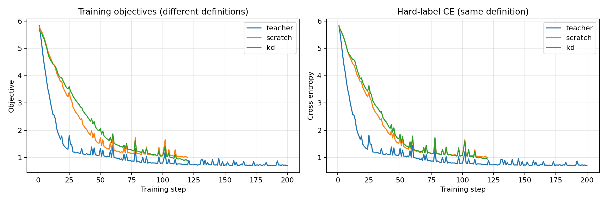
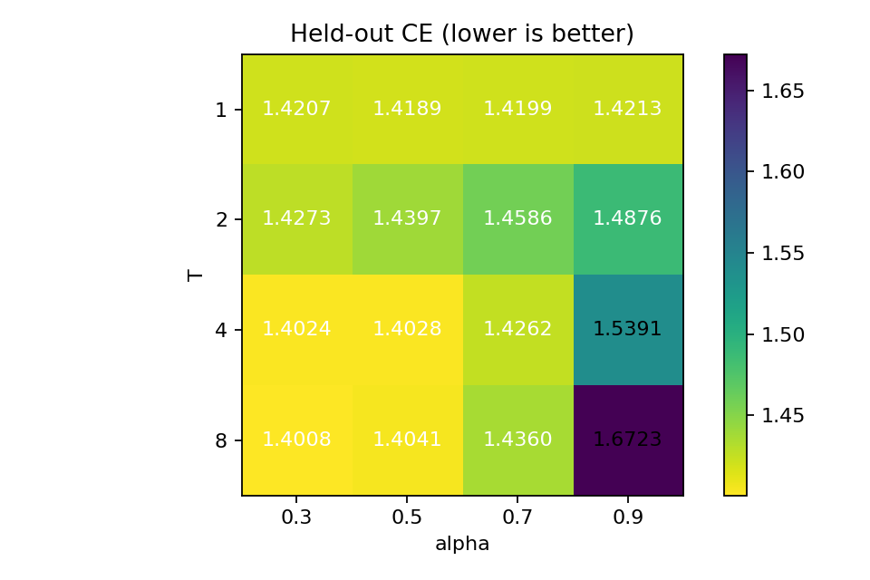

# CPU 语言模型知识蒸馏

本实验从零训练字符级 Transformer 教师，将知识蒸馏到参数量为其 1/5 的学生，并在同初始化、同数据顺序和同训练预算下比较从零学生。Notebook 保留完整代码展示、实际运行输出、图表和分析。

- [完整实验 Notebook](experiment_record.ipynb)
- [模型与训练代码](distill_lm.py)
- [公开实验结果](results/)

## 实测结果

| 模型 | 参数量 | 训练步数 | 留出 CE | PPL | 教师一致率 |
| --- | ---: | ---: | ---: | ---: | ---: |
| 教师 | 737,280 | 200 | 0.832208 | 2.298388 | — |
| 从零学生 | 147,456 | 120 | 1.272223 | 3.568778 | 63.8780% |
| 蒸馏学生 | 147,456 | 120 | 1.210737 | 3.355957 | 68.6133% |

默认温度4、权重0.5。蒸馏降低学生留出 loss 4.8330%，一致率增加4.7352个百分点。16组消融各80步，最优为 T=8、α=0.3，loss=1.400758；消融使用32批循环缓存，与主实验采样和步数不同，仅在网格内部比较。

额外特征蒸馏未改善 loss（1.219032）；教师宽度96、160、256对应学生收益2.4410%、4.8330%、0.6621%，收益不随教师规模单调增加。动态INT8将学生文件从617,785缩小至267,651字节（2.3082倍），loss增加0.000745；批量前向中位延迟从4.7830变为4.8999ms，本次未测得加速。




## 运行

打开 `experiment_record.ipynb`，选择装有依赖的 Python 内核，按顺序执行并保存。Notebook 是统一入口，涵盖环境检查、正式对照、16组消融、特征蒸馏、教师规模扫描、动态量化和数据导出。无需下载预训练权重或外部语料。

```text
python -m pip install torch --index-url https://download.pytorch.org/whl/cpu
python -m pip install matplotlib ipython ipykernel
```

实际运行环境为 Windows 11、Python 3.13.3、PyTorch 2.6.0+cu124，Intel Core i7-14650HX，16核24线程，约32GB内存；PyTorch统一4线程，所有模型与张量使用CPU，未使用GPU。新环境建议使用CPU版PyTorch；版本、后端与机器差异可能影响数值和延迟。

命令行仅作为辅助入口：

```text
python distill_lm.py --mode quick
python distill_lm.py --mode teacher --retrain
python distill_lm.py --mode all
python distill_lm.py --mode ablate
```

正式结果写入 `runs_distill/formal/`，自检写入 `runs_distill/quick/`；缓存和模型权重不发布，可从代码重新生成。已完成阶段在配置匹配时复用原始记录；改参数时应修改 Notebook 的 `RUN_NAME`，避免混用缓存。`quick` 仅用于连通检查，不作为正式结果。

## 数据与结果说明

数据为固定槽位文法生成的仿古句及公版古诗，训练/留出随机种子分别0/999，长度52,456/5,656字符，词表322。训练与留出共享固定古诗片段，因此不是完全无重叠的泛化测试。所有模型用固定20批留出样本评价，PPL=exp(留出CE)，一致率为同批逐token top-1匹配率。三组生成样例均为提示“月”之后新增60字符，采样温度0.9、top-k=20、种子2026。

`results/` 包含三模型指标、16组消融、三组生成样例、特征对照、教师扫描、量化结果、参数手算、原始训练序列CSV及三张PNG。Notebook保留初始近似参数公式的实际输出，并补充偏置与LayerNorm项 `28C` 后的精确计算。训练总目标口径不同，图中另外展示统一硬标签CE。

结果来自一次随机种子和有限预算；生成文本仍有语法断裂，不能声称稳定生成完整诗句。特征匹配、师生适配和量化速度的原因解释未经过额外机制消融；Notebook中明确区分实测与后续实验设计。
